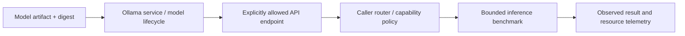

# Fork qualification notes — Ollama model-service integration

**Scope:** public model-service fork and reproducible local inference experiments. A fork in GitHub is not itself a running model service.

Research tracks model selection and aliasing, memory/CPU utilization, process isolation, idempotent config changes and migration comparisons with independent llama.cpp servers. The upstream Ollama service owns its own model store/daemon semantics; an application's router may address it but does not inherit host/runtime mutation authority.

For any accepted deployment pin executable, exact model digest, service identity, endpoint and version; test health, named model, streaming, cancellation, concurrency, error/missing-model path and no unauthorized cross-project traffic. A passing HTTP health probe is **not** proof that all models, routes and consumers work.

This source note preserves upstream MIT licensing and excludes private model paths, credentials and infrastructure details.
